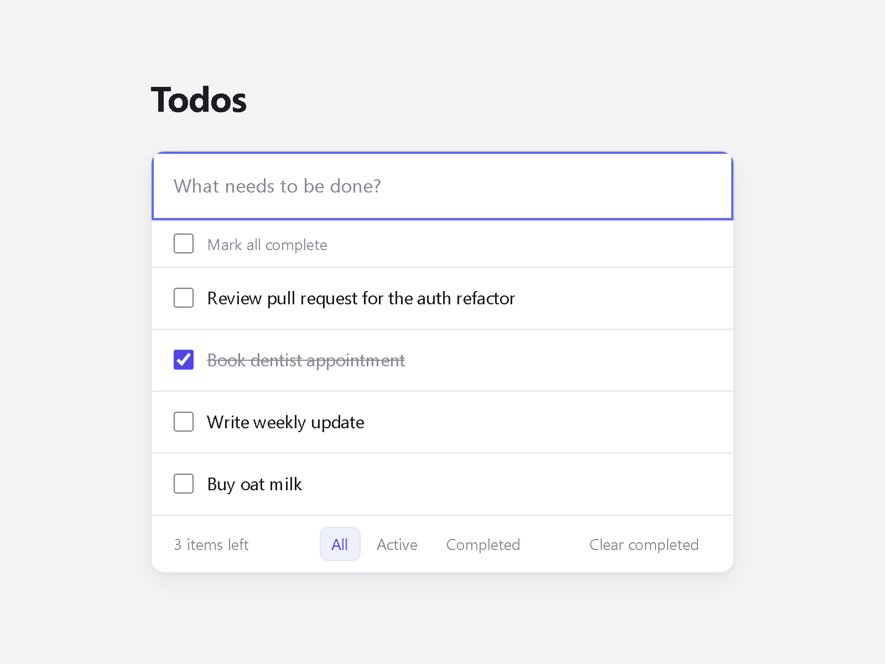

# Todos

A small, polished todo app built with React and TypeScript. It has deliberately few features, and each one is accessible, tested, and works without a backend.



## Features

- Add, complete, edit (double-click or the Edit button) and delete todos
- Filter by All, Active or Completed
- "Mark all complete" and "Clear completed"
- Todos persist in `localStorage`
- Follows your system's light or dark theme
- Fully usable with a keyboard and screen reader

## Tech stack

- [Vite](https://vite.dev/), [React](https://react.dev/), TypeScript (strict)
- CSS Modules with CSS custom properties for theming
- [Vitest](https://vitest.dev/), [React Testing Library](https://testing-library.com/docs/react-testing-library/intro/) and user-event
- [oxlint](https://oxc.rs/docs/guide/usage/linter)

## Getting started

```bash
npm install
npm run dev
```

## Scripts

| Command | What it does |
| --- | --- |
| `npm run dev` | Start the dev server |
| `npm run build` | Type-check and build for production |
| `npm run test` | Run the test suite once |
| `npm run test:watch` | Run tests in watch mode |
| `npm run lint` | Lint the project |

## Design decisions

- **All todo logic lives in a pure reducer.** `todosReducer` has no React or browser dependencies. The hook supplies IDs and timestamps, so the reducer is deterministic and is unit-tested directly.
- **No state or UI libraries.** `useReducer` plus a custom hook (`useTodos`) handles everything this app needs. Components are presentational and receive data and callbacks as props.
- **Storage is untrusted.** `loadTodos` validates every saved entry and falls back to an empty list on corrupt data or a storage error. `saveTodos` swallows write failures, so the app keeps working in memory.
- **Accessibility built in.** The app uses native controls, every control has a descriptive name (for example, `Delete "Buy milk"`), the filter buttons use `aria-pressed`, the remaining count is announced through a polite live region, and focus is always visible.
- **Edge cases tested.** The tests cover cancelling an edit with Escape (the following blur doesn't save it), Enter during IME composition (doesn't submit), duplicate titles, and editing a title to blank (deletes the todo).

## Project structure

```
src/
  todos/          # domain logic: types, reducer, filters, storage, useTodos hook
  components/     # TodoApp and its presentational components (+ CSS Modules)
  test/setup.ts   # Testing Library matchers, storage reset between tests
```
